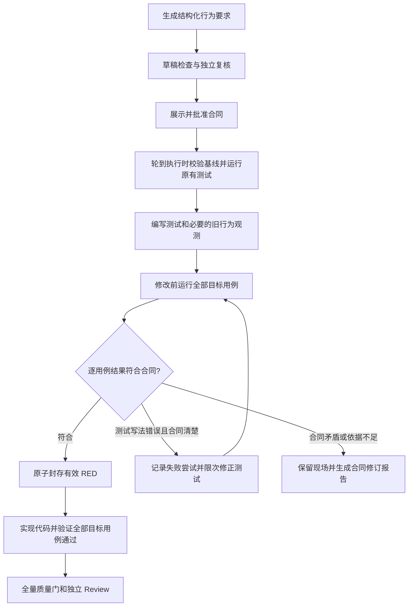

Orchestrator 合同与测试预期校验方案

设计日期：2026-09-17。针对插件 1.0.4 的现有实现，以及 WordPress 的 `TASK-DEBUGSAFE-001` 失败记录。本文是待实现方案，所列新字段、命令和状态信息当前尚不可使用。

目标是减少规划阶段对现有行为的错误推断，并保证正式 RED 证据只包含与批准需求相符的失败。推荐组合使用结构化验收要求、修改前验证、逐用例报告检查和独立复核；提示词负责指导，脚本负责决定是否放行。

**问题依据。** 当前任务的合同要求保留 `encode` 输出，计划却将输出推断成只有三个字段的 JSON，并将该推断写成必须照做的精确断言。实际测试是 9 个用例、6 个失败，其中 4 个属于待修复行为，另外 2 个来自错误的兼容性断言；生产代码尚未修改。`record-red.sh` 只要求非零退出码以及日志包含指定文字，所以这次混合失败被记录成正式 RED。后续流程发现计划矛盾后正确停止，但错误证据已经封存。

依据文件：

- [WordPress 计划](/Users/zhanglong/files/program/wordpresslocal/WordPress/docs/plans/TASK-DEBUGSAFE-001.md:44)：第 8 项验收条件写入错误字面量，后文又禁止调整。
- [任务阻塞记录](/Users/zhanglong/files/program/wordpresslocal/WordPress/.git/automation-runtime/state/TASK-DEBUGSAFE-001.json:7)：记录计划预期与实测输出不一致。
- [JUnit 报告](/Users/zhanglong/files/program/wordpresslocal/WordPress/WordPress/build/test-results/testWordpressDebugUnitTest/TEST-org.wordpress.android.ui.debug.cookies.DebugCookieTest.xml:2)：9 个用例、6 个失败。
- [RED 脚本](/Users/zhanglong/files/npmprogram/opencode_android_orchestrator/templates/scripts/automation/record-red.sh:34)：正式记录不可覆盖，但写入前缺少逐用例校验。

**1. 让合同表达行为，把猜测留在待验证项中。**

每项验收条件获得稳定 ID，并声明其依据：用户要求、保留旧行为、已有测试，或者待实测事实。涉及反射、序列化、日期解析等运行结果时，不能把只根据字段声明或库语义推断的字面量标为“已验证”。

将验收条件、非目标和测试分类放入合同的结构化数据中；计划中的验收表由这些数据生成。实现步骤可以解释方法，但不能再独立增加一套精确预期。测试代码示例明确为实现参考；Coder 必须满足结构化行为约束，无需逐字复制示例。

合同和计划仍整体封存。发现正文新增了约束或与结构化数据冲突时，返回草稿修订，不允许 Coder 自行选择采用哪一处。脚本可以检查 ID、来源、引用、覆盖关系以及已结构化的冲突；自然语言的语义矛盾由独立复核补充判断。

测试预期按下表表达：

| 类型 | 修改前 | 修改后 | 预期值依据 |
| --- | --- | --- | --- |
| 保留旧行为 | 必须通过 | 必须通过 | 固定旧基线的输出，或已有可信断言 |
| 明确的缺陷复现 | 必须以指定原因失败 | 必须通过 | 已批准的目标行为 |
| 当前表现尚不确定的边界 | 实测通过或符合声明原因的失败 | 必须通过 | 已批准的目标行为，修改前结果只作观测 |

第三类用于空串等“目标明确、旧表现尚未验证”的输入，避免强迫所有非法输入都在修改前失败。每个待修复行为至少要有一个明确的缺陷复现用例；不能把所有用例都标为不确定以绕过 RED。未预期的异常、初始化失败和编译错误不属于允许观测的行为失败。

建议新增 `verification` 数据，以下只是字段示意，不是可直接提交给 1.0.4 的合同：

```json
{
  "verification": {
    "version": 1,
    "maxPreparationFixes": 1,
    "cases": [
      {
        "id": "COOKIE-ENCODE-VALUE",
        "criterionId": "AC-ENCODE-PRESERVED",
        "intent": "preserve",
        "before": "pass",
        "after": "pass",
        "expectation": {
          "source": "baselineCapture",
          "comparison": "exactString",
          "captureId": "cookie-encode-with-value"
        }
      },
      {
        "id": "COOKIE-MALFORMED",
        "criterionId": "AC-DECODE-INVALID",
        "intent": "change",
        "before": "fail",
        "after": "pass",
        "expectation": {
          "source": "approvedRequirement",
          "value": null
        },
        "expectedFailure": {
          "type": "com.google.gson.JsonSyntaxException",
          "origin": "decode invocation for the declared malformed input"
        }
      }
    ]
  }
}
```

完整定义还需包含输入、调用入口、Gson 等必要配置、受测路径、Gradle task、测试类和用例名。测试 ID 与报告中的 `(Gradle task, classname, testcase name)` 一一绑定，不能仅绑定日志关键词。参数化测试必须使用稳定的参数标识；独立边界输入不要塞进遇到首个断言失败就停止的 `forEach` 中。

**2. 在生产代码修改前，验证测试本身。**

保留现有绿色项目基线检查，在新增测试之后加入测试预检。项目原有测试全绿，只能说明原有测试通过，不能证明新写的兼容性断言正确。

建议流程如下，图中“预检”是执行阶段，不要求首期新增队列主状态：



Planner 当前只能读取固定提交快照，不能执行 shell。继续保持这一边界：草稿阶段进行静态检查；运行期实测由持有执行槽和工作区租约的执行器完成。前台不必等待另一个任务释放工作区，也无需为了规划而启动第二个 WordPress 构建。

实测使用实际执行基线 `executionHead`。沿用已有 `planningHead` 与执行基线变化检查，并将新增观测依赖的路径纳入相关性判断。与观测有关的代码、资源、构建配置变化时，旧证据不可直接复用。

预检前后均检查：除批准的测试变更、必要的观测代码和固定规划文件外，受控源码与配置仍对应执行基线。发现生产代码已经变动，拒绝生成有效 RED。此检查用于约束证据有效性；如果后续需要在编辑发生时就阻止提前修改，可以再把测试编写与生产实现拆成不同编辑权限的会话。

对于 `encode` 这类“输出保持不变”的要求，采用合同预先批准的基线采样规则：固定输入、入口、配置和比较方式，在旧生产代码上通过项目自身的测试环境获取实际值。观测程序也需要复核，不能只相信模型打印出的声称结果。记录观测程序、生产输入、运行环境和输出的摘要。

采样得到的固定值写入允许提交的测试常量或测试数据文件，文件数仍受合同限制；对应证据另存运行目录。以后测试只读取固定值，不自动更新。修改后禁止重新采样覆盖旧预期，也不能用修改后实现同时计算 actual 和 expected。

该机制只用于明确要求保留的旧行为。新行为的目标值仍来自需求，不能从旧实现抄出。比较粒度由合同指定：本例保留精确字符串，包括字段、顺序和转义，不能自动改成忽略这些差异的 JSON 比较。

基线采样是在执行用户批准的“保持旧行为”验证规则，无需额外增加每次采样的人工确认；改变行为、输入范围或比较强度，才需要修订合同。

**3. 把 RED 脚本改成逐用例证据门。**

建议保留 `record-red.sh` 作为受限入口，由同一验证模块完成预检和 RED 判定；命令根据封存合同选择目标，不让 Coder 传一段宽泛关键词作为通过条件。正常情况下运行一次完整目标测试集合，同时检查保留行为和缺陷复现，避免重复执行两轮全量测试。

Gradle 可以提供逐用例 JUnit XML，并配置各测试任务的报告输出位置。因此可以使用结构化报告，不必从终端摘要推测失败归属。[Gradle 测试报告文档](https://docs.gradle.org/current/userguide/java_testing.html#sec:test_reporting)

通过条件必须全部满足：

1. 每个声明用例均被实际执行；任务路径、测试类、用例名或参数 ID 匹配。目标用例不能缺失、跳过或重复归属；额外发现的用例必须有明确分类。
2. 所有“保留旧行为”用例通过。任一失败都不能作为缺陷修复所需的 RED。
3. 所有明确缺陷复现用例以声明的原因失败，且至少存在一个真实缺陷失败。观测类边界用例的结果符合预先声明的允许范围。
4. 失败类型、相关断言或受测调用位置与预期一致。不能仅因异常名相同就认定原因正确；脚本无法判定的语义问题交给复核。
5. 没有编译、依赖解析、测试初始化、进程崩溃等额外问题；测试任务的失败必须可以完整归因到允许失败的用例。
6. 报告与本次运行绑定，完整且可解析，生产基线和测试输入校验通过。

为保证报告新鲜，每次尝试使用唯一的运行目录，并按 Gradle task 分目录存放报告；多模块同名测试不会相互覆盖。对目标 Test 任务禁用结果复用和 dry-run，关闭提前终止，校验执行完成记录、逐用例报告和汇总计数一致。不能仅根据文件修改时间、退出码或旧 `build/test-results` 中已有 XML 判定通过。

现有 `lib.sh` 已经对全量单测实现了强制实际执行，可抽取这一机制扩展至聚焦测试。XML 使用正式解析器读取；格式损坏或内容不完整时拒绝封存。具体 Gradle 接口需在项目当前 wrapper 9.4.1 及插件支持的版本上验证。

这样，本次任务的 6 个失败会被识别为“4 个预期失败 + 2 个保留行为用例异常”，预检失败，正式 `red.json` 不会产生。修正测试预期后，若按原来的 9 个测试方法统计，应得到 5 个通过、4 个符合预期的失败，才可进入实现。未来拆分参数用例后数量会变化，应比较用例清单，不能硬编码 9/4。

**4. 失败尝试可重试，已确认的事实保持可追溯。**

建议新增以下运行证据，全部由执行器写入，通过状态工具供 Coder、Reviewer 和用户读取：

| 证据 | 内容与用途 |
| --- | --- |
| `baseline-observations.json` | 旧行为采样、基线、输入配置、观测程序与输出摘要 |
| `test-manifest.json` | 批准行为 ID 与实际测试身份、测试源文件和测试数据摘要的绑定 |
| `attempts/<runId>/<attemptId>/` | 每次尝试的日志、XML、完成记录和判定，包括失败尝试 |
| `test-preflight.json` | 当前预检结果、异常用例、原因分类和下一步 |
| `red.json` | 只有全部 RED 条件满足后才原子创建，引用已完成的有效尝试 |

`red.json` 绑定合同 digest、任务版本、执行基线、测试清单、测试源码、测试数据和报告摘要。写入前再次校验，临时文件或未完成的尝试不可提升为正式证据。`verify-task.sh` 和最终质量门验证这些绑定关系，不能只判断文件存在。

首期冻结参与 RED 的测试文件和数据；新增独立回归测试可以走原有范围检查和 GREEN 验证。确需修改原 RED 测试时，不能直接让旧 RED 继续有效，需要明确的重新验证流程或新合同任务。后续可增加在隔离基线上验证新版测试的能力，保留前后两套证据，避免在当前工作区回滚生产实现。

测试准备阶段可以在批准的 `maxPreparationFixes` 内修正 import、调用写法、错误夹具生成等问题。该预算与生产实现的 `maxFixLoops` 分开。每次修改都重新运行预检；不得通过减少测试、改分类、跳过用例或放宽断言通过。

是否属于“测试写法错误”不能仅凭机器错误码决定。必须能够证明合同要求清楚，修正后的测试与批准要求或封存采样一致。若预期值已被合同明确固定成错误值，或者修改会改变需求，就生成合同修订报告并停止，不自动改约。

首批适用于已有可调用 API 的行为修复。新增 API 尚不存在所产生的编译失败，需要另行设计测试准备规则，不能当作本方案允许的行为 RED。

**5. 补充三段可复用提示词。**

Planner 提示词补丁：

```text
为每项验收条件标注稳定 ID、依据来源、修改前预期和修改后预期。
区分用户要求、保留的旧行为、已验证事实、尚待实测的判断。
不要仅凭字段声明或第三方库印象，固定序列化等运行结果的字面量。
保留旧行为但缺少实测值时，声明固定输入、配置和比较规则，
由执行器在旧基线上采样；不得将该机制用于推导新行为的目标值。
计划中的验收表与合同共用一份结构化数据，代码示例不新增约束。
逐项检查 acceptanceCriteria、nonGoals、测试预期是否互相矛盾。
不确定旧行为的边界用例声明为待观测，不编造必然失败的原因。
发现矛盾时先修订草稿，再展示最终合同供用户确认。
```

Coder 提示词补丁：

```text
先保持生产代码不变，编写批准范围内的测试并调用测试预检入口。
检查逐用例结果：保留行为必须通过，缺陷复现必须按声明原因失败。
日志出现预期异常名，不代表整个测试集合具有有效 RED。
只有脚本返回有效并封存 RED 后，才开始生产实现。
预检失败时，根据报告区分测试写法问题、合同矛盾和执行环境问题。
测试写法问题仅在批准的准备预算及语义范围内修正，并重新预检。
合同矛盾须报告冲突的条件 ID、预期与实测值，不修改合同或分类。
不删除正式证据，不重新生成旧行为预期，不通过跳过或弱化测试通关。
```

独立复核提示词补丁：

```text
从固定代码快照、需求和受控证据独立判断，不以 Planner/Coder 的结论为依据。
检查每个精确预期的来源；涉及框架运行行为的推断不能冒充实测。
检查每个用例的分类、输入与验收条件对应关系，以及非目标约束。
特别检查保留行为用例是否在修改前已经通过。
确认 RED 中没有额外失败，失败位置对应受测行为而非夹具或初始化。
检查生产实现后仍使用原封存测试和旧行为预期。
无法证实时标记待验证或提出具体修订，不能凭测试总数或异常关键词批准。
```

正式实现时同步调整 agent 和 skill 模板。现有 Reviewer 只在 `REVIEWING` 状态运行，不能直接把它提前调用：草稿复核需要单独的只读入口和受限快照权限。先保证脚本门禁落地，再接入这一前置复核；实现完成后的独立 Review 继续保留。

**6. 把用户可见的失败原因和恢复动作做清楚。**

首期继续使用现有 `BLOCKED` 主状态，增加 `phase`、`reasonCode`、失败用例列表、原因说明和可执行的下一步。执行器退出后，队列应优先保存结构化原因；`exited with 1` 只作为补充。

| 判定 | 处理 |
| --- | --- |
| 明确的测试写法问题，合同无矛盾 | 在准备预算内自动修正，再次预检 |
| 保留行为与合同固定预期冲突 | 产出修订建议，需要新的合同确认 |
| 编译、依赖或环境问题 | 显示执行阶段与错误证据；修复后按恢复规则重跑，不算有效 RED |
| 实现后的目标测试失败 | 按原有生产修复预算处理 |
| 证据、测试或执行基线发生变化 | 拒绝继续使用旧证据，提示重新验证或重新规划 |

本例应显示：“测试预检未通过：2 个保留行为用例与旧基线不一致；4 个缺陷用例符合预期；生产实现尚未开始。计划中的 encode 固定预期与实测冲突，需要修订合同。”

工作区策略为 `inPlaceExclusive` 时，保留失败现场会继续占用仓库。队列应清楚显示后续任务在等待哪个任务处理；不能仅把队列标成恢复，也不能在未处理占用时承诺继续下一项。

对已经执行并封存错误证据的 `TASK-DEBUGSAFE-001`，仍需走现有批准中止与归档流程，再创建纠正后的新任务。当前队列不支持直接复用已执行任务 ID；简单 `/resume-task` 或删除 `red.json` 不能解除合同矛盾。未来可以做一个修订入口，集中展示原任务、差异与恢复动作，再由现有确认凭据驱动归档及新任务入队。

**7. 按两批落实，优先让错误证据无法通过。**

| 批次 | 改动 | 主要落点 |
| --- | --- | --- |
| 第一批 | 测试分类、来源声明和统一合同校验 | `task-contract.schema.json`、`src/queue/queue.ts`、`validate-contract.sh` |
| 第一批 | 新鲜逐用例报告、修改前预检、严格 RED、失败尝试保留 | `record-red.sh`、`lib.sh`、新增验证模块 |
| 第一批 | 证据与基线、测试摘要绑定；最终复验 | `verify-task.sh`、`quality-gate.sh`、状态证据输出 |
| 第一批 | Planner/Coder 提示词和具体失败信息 | agent/skill 模板、`src/queue/executor.ts`、队列协调与通知 |
| 第二批 | 受控基线采样、固定测试数据生成、独立草稿复核 | 新增观测入口、草稿校验流程、只读复核入口 |
| 第二批 | 合同修订与旧任务归档的集中操作 | intake、queue review、批准凭据与恢复流程 |

第一批尚无通用采样入口时，已有运行证据可引用；未验证的精确兼容性值必须标记待验证并按预检结果处理，不能声称采样能力已经存在。脚本对这次“保留用例额外失败”的拦截不依赖第二批功能。

当前还有一个必须随新字段一起处理的问题：JSON Schema 只声明版本 2，队列校验接受 1/2/3，shell 校验接受 1/2。应共享同一份字段规则并覆盖入口一致性；不能只把合同版本改成 3 就认为新能力已经生效。

旧任务和旧证据维持原版本含义，不批量重写摘要或审批。新版严格合同应在插件、项目模板、执行器一致升级后生成；需要新验证能力的未执行旧合同重新生成并确认。活动任务的升级时机沿用项目现有生命周期检查。

**8. 用这次故障作为必须通过的验收案例。**

| 场景 | 必须得到的结果 |
| --- | --- |
| 重放本例：4 个预期失败，2 个兼容性断言失败 | 预检拒绝，列出两个异常用例，不生成正式 RED，不进入生产实现 |
| 修正旧行为预期，5 个通过、4 个指定失败 | 生成与该基线和测试绑定的 RED，允许实现；实现后 9 个全部通过 |
| 日志包含 JsonSyntaxException，但实际编译失败 | 拒绝 RED，分类为构建问题 |
| 错误 filter、零测试、漏用例、跳过用例 | 拒绝 RED，并指出缺失或未执行的 ID |
| 报告来自缓存或旧运行、文件损坏、执行中断 | 拒绝正式封存，原始尝试保留 |
| 不同模块中存在同名测试 | 按 Gradle task 分别匹配，不混合统计 |
| 某边界用例在旧代码已通过 | 若声明为观测则记录通过；若声明为必败则指出分类不符，不制造失败 |
| 正式 RED 后修改原测试、旧行为固定值或基线 | 质量门拒绝使用旧证据 |
| 预检失败后的限次测试修正 | 保留两次尝试，成功尝试才可生成正式 RED，合同语义与摘要不变 |
| 同一个合同分别经过 draft、shell 和升级校验 | 接受或拒绝结果一致，错误定位一致 |
| 队列执行器退出 | 状态保留具体原因与下一步，后续任务正确说明工作区等待原因 |

验证分两层：Node/脚本测试覆盖报告解析、判定和队列状态；真实 Gradle 最小工程覆盖 XML、新鲜执行、多模块和失败退出行为。WordPress 场景可在隔离测试副本中复现，不以修改当前阻塞任务作为验证手段。最终仍需跑插件原有回归、模板迁移和打包检查。

本方案能确定性拦截已声明保留行为的额外失败、伪 RED 和过期证据；业务预期是否正确仍需可靠的需求来源、基线观测及独立复核共同支持。它降低错误发生率，并让错误在生产实现前得到可追溯的处理。
