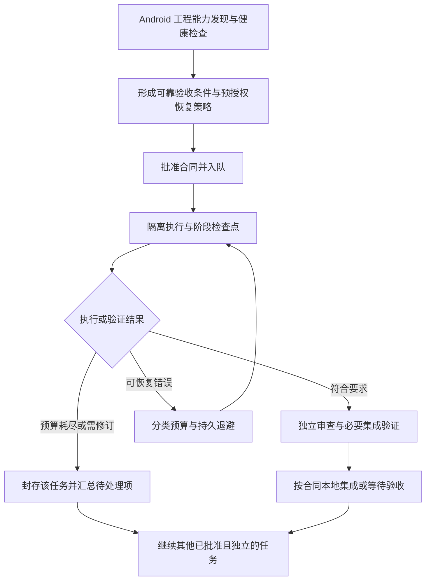

# Orchestrator Android 工程普适性与长期运行方案

审核日期：2026-09-26。

2026-09-30 实现追踪：[逐项核对、已补齐内容与剩余任务](../progress/orchestrator-android-continuity-progress.md)。V5 基线恢复、V6 Worker 安全终止、V7 阶段验证恢复、Android 工程能力模型及显式嵌套构建根已同步产品源码；第七轮进一步交付 V8 显式授权的隔离自动本地集成和声明式规划输入刷新。最新 Node 完整回归 318/318、Shell 46/46、真实 Android 两任务自动集成链 1/1 通过，28 个审阅文件已同步；真实 Android 的 Gradle/JUnit 实际执行，Coder/Reviewer 为模拟响应。此前真实嵌套 Android 1/1 验证仍单独保留。尚不包含任务类型、追加证据、模型供应商自动恢复、成本预算、跨恢复任务总时限、复合构建或长期运行验收。完整验证记录和边界见进度文档。下文保留审核当时的事实和完整验收清单；不能将局部修复等同于整体长期运行验收完成。

审核对象：`/Users/zhanglong/files/npmprogram/opencode_android_orchestrator` 当前源码及未提交的 V4 清单补修，结合合同验证设计、队列文档和验收记录。采用源码调用链审查和三路独立复核；本次没有修改插件实现，没有重跑完整测试，也没有进行真实模型连续运行测试。

范围确认：按用户要求，插件仅面向 Android 工程。“普适性”指不同 Android 工程的单模块、多模块、模块命名、构建变体和目录组织均可适配。本轮不支持独立 JVM、前端、后端等其他工程，也不为这些技术栈设计扩展接口。宿主环境沿用当前 macOS 支持边界。

Android 工程内部的 Java/Kotlin 库模块属于适配范围：只要它们属于所选 Android 构建、参与 Android 产物的依赖链，就应纳入模块、源码和验证任务识别。这不代表支持独立 JVM 工程。仓库中与所选 Android 构建无关的其他项目不自动纳入修改或验收范围。

## 审核结论

当前实现已有跨 Android 工程基础，未在产品源码和模板中发现 WordPress、Jetpack、FluxC 专用名称绑定；相关名称主要出现在发现逻辑的测试夹具中。真正限制普适性的，是 Android Debug、固定源集路径及单一行为变更验证流程等假设。

本轮目标适配范围如下；这是待实现、待验收的目标，不表示当前均已支持：

| Android 工程形态 | 适配要求 |
| --- | --- |
| 单模块应用或 Android 库工程 | 从真实构建模型识别应用/库模块及 APK/AAR 构建任务；不要求存在应用模块，不依赖模块名为 `app`、固定包名或固定测试类 |
| 多模块 Android 工程 | 识别应用、Android 库、参与 Android 模块依赖的 Java/Kotlin 库及模块依赖；允许合同在批准范围内跨模块修改，测试身份使用完整任务路径 |
| 多 build type / product flavor | 识别实际注册的变体和任务；按工程策略选择验证矩阵，Debug 可作默认值，任务名不写死 |
| 自定义工程目录 | 识别 `projectDir`、自定义生产/测试源集、资源目录及嵌套 Android 构建根；编辑权限仍由合同限定 |
| 不同 Gradle 配置写法 | 保留对 Kotlin/Groovy DSL、动态模块声明、版本目录及 convention plugin 的发现能力，以 Gradle 运行时模型为准 |
| 不同测试配置 | 区分可用的本地单测、lint 和设备测试能力；只将工程策略及任务要求的检查设为必需门槛，缺少必需能力时明确说明 |

多模块工程中的公共库改动，应识别受影响的 Android 消费模块，并按批准的验证矩阵覆盖；不能只验证发生文件修改的模块。对依赖影响无法可靠判断时，回退到所选 Android 构建的已配置全量验证。

当前方案适合范围较小、基线全绿、有人工处理异常的任务。要达到长期运行目标，仍需补齐任务失败隔离、分类重试、阶段恢复、适当的任务类型验证和运行资源管理。提高重试次数只能解决其中一部分。

上轮 F01–F05 的完成结论针对 V4 清单补修；本报告对整体执行链发现了另外两处具体缺陷，并提出适应新目标的设计调整。这些应另建整改清单，不能沿用“清单补修全部完成”作为长期运行能力的验收结论。

已有能力应保留：持久队列、动态 Android 模块/任务发现、聚焦范围自动回归清单、真实测试执行证明、RED/GREEN 摘要绑定、最新 GREEN 失败后作废旧成功、有限 Coder/Review 修复、隔离 worktree、进程所有权检查和本地提交事务。

## 一、优先修复的具体缺陷

### 1. Reviewer 恢复调用与脚本参数不一致

队列执行器对 `resume-review` 传入 `[taskId, approval]`，但 `resume-review.sh` 要求恰好一个参数，否则退出码为 2。因此通过队列发起的 Reviewer 恢复会在入口失败。

证据：[executor.ts:398](/Users/zhanglong/files/npmprogram/opencode_android_orchestrator/src/queue/executor.ts:398)、[resume-review.sh:9](/Users/zhanglong/files/npmprogram/opencode_android_orchestrator/templates/scripts/automation/resume-review.sh:9)。

处理建议：统一受控入口的参数协议，保留队列审批凭据验证；用实际 Shell 脚本覆盖“Reviewer 无决策退出 → 批准恢复 → 原候选重新审阅”的完整路径。

### 2. 固定八步循环不能执行配置允许的第二轮 Review 修复

配置 Schema 允许 `maxReviewCycles=2`，默认值为 1。编排脚本却固定运行八个状态步骤。在两次 Review 均要求修改时，第八步只把状态切回 CODING，随后就因步数耗尽退出，第二次修复尚未运行。

证据：[config.schema.json:88](/Users/zhanglong/files/npmprogram/opencode_android_orchestrator/templates/automation/config.schema.json:88)、[orchestrate-task.sh:66](/Users/zhanglong/files/npmprogram/opencode_android_orchestrator/templates/scripts/automation/orchestrate-task.sh:66)、[resume-review-fix.sh:16](/Users/zhanglong/files/npmprogram/opencode_android_orchestrator/templates/scripts/automation/resume-review-fix.sh:16)。

处理建议：让执行循环与批准的阶段预算一致，另设防止状态空转的上限；验收覆盖零轮、一轮、两轮修复及预算耗尽，不仅验证默认成功路径。

以上两项由参数和控制流直接确认，尚未在本次审核中运行端到端复现。

## 二、导致任务和队列频繁停下的设计

### 3. 默认固定目录模式会放大单任务失败的影响

默认策略为 `inPlaceExclusive + humanApproval`。保留工作目录的非终态任务会阻止其他任务启动，包含失败和等待人工验收。已有 `isolatedWorktree` 能在进程退出且现场封存后释放租约、继续独立任务，但当前禁止它与 `autoCommit` 组合。

证据：[QUEUE.md:21](/Users/zhanglong/files/npmprogram/opencode_android_orchestrator/docs/QUEUE.md:21)、[queue.ts:560](/Users/zhanglong/files/npmprogram/opencode_android_orchestrator/src/queue/queue.ts:560)、[queue-policy.ts:16](/Users/zhanglong/files/npmprogram/opencode_android_orchestrator/src/config/queue-policy.ts:16)。

建议提供明确的持续运行模式：隔离执行，失败候选保留，独立任务继续；本地集成仍使用单执行槽。进一步支持在合同预先批准的范围内自动集成本地结果。依赖任务必须等前置任务真正完成集成，不能把失败隔离当作依赖已完成。现有合同的人工验收策略不能被升级自动改变。

当前立即可用的折中是隔离执行加人工验收，但它仍受保留工作区数量和磁盘限额约束，也不适合长期无人处理验收的使用方式。

### 4. 环境错误、代码错误和全局故障区分不足

RED 按尝试目录消耗准备预算；质量门按调用次数消耗修复预算，最多一次修复。网络、构建环境和真实断言失败没有独立预算。Reviewer 独立验证失败也转为 `CHANGES_REQUESTED`。此外，任意 Agent 非零退出会写入全局 `fault`，使整个队列停止消费，直到人工清除。

证据：[inventory.cjs:326](/Users/zhanglong/files/npmprogram/opencode_android_orchestrator/templates/automation/verification/inventory.cjs:326)、[quality-gate.sh:28](/Users/zhanglong/files/npmprogram/opencode_android_orchestrator/templates/scripts/automation/quality-gate.sh:28)、[submit-review.sh:37](/Users/zhanglong/files/npmprogram/opencode_android_orchestrator/templates/scripts/automation/submit-review.sh:37)、[executor.ts:429](/Users/zhanglong/files/npmprogram/opencode_android_orchestrator/src/queue/executor.ts:429)。

建议由执行器记录结构化失败类别、阶段、可重试性、下次运行时间及预算消耗；类别无法可靠确定时保留为未知错误，不能自动归为环境抖动。

| 失败类型 | 自动处理方向 | 超出处理能力后的行为 |
| --- | --- | --- |
| 已识别的限流、临时网络或环境故障 | 保留尝试，指数退避并加入随机延迟；使用独立环境预算 | 挂起该任务或对应服务的工作，定期健康探测 |
| 合同清楚的测试准备错误 | 在允许范围内修正测试，重新预检 | 隔离任务并汇总原因 |
| 生产实现未达到已批准要求 | 根据具体失败进行有限修复 | 保留候选，继续其他独立任务 |
| Review 发现实现问题 | 有预算地修复并重新独立审阅 | 保留候选，等待处理 |
| 合同矛盾、真实需求或范围改变 | 生成修订草稿和差异 | 等待针对修订的确认，其他独立任务继续 |
| 证据失效、越权、进程所有权不明 | 停止相关任务，保留完整证据 | 仅在影响共享资源安全时阻断整个执行队列 |

预算同时限制次数、总耗时和模型成本。同一错误反复出现且没有新的修复或诊断进展时应提前停止尝试。重启服务不能重置预算或绕过已批准的限制。

### 5. 基线采集缺少阶段恢复

`claim-task.sh` 在清单采集前写入 `baseline.json`；全量基线失败也会写入它。V4 恢复脚本只要发现该文件就拒绝恢复。因此临时失败可能要求归档、重新批准并重建任务，即使产品代码尚未修改。

证据：[claim-task.sh:50](/Users/zhanglong/files/npmprogram/opencode_android_orchestrator/templates/scripts/automation/claim-task.sh:50)、[claim-task.sh:75](/Users/zhanglong/files/npmprogram/opencode_android_orchestrator/templates/scripts/automation/claim-task.sh:75)、[resume-task.sh:58](/Users/zhanglong/files/npmprogram/opencode_android_orchestrator/templates/scripts/automation/resume-task.sh:58)。

建议把尝试记录与成功基线分开，记录各阶段的完成点。合同、执行 HEAD、输入摘要和工具配置均未变化、旧进程已退出且尚无产品修改时，允许按预先批准的策略继续未完成采集；成功封存的基线保持不可覆盖。完整采集后发现真实历史失败，应交给专门的基线修复流程。

### 6. 测试冻结阻断合理的 Review 补测

GREEN 要求整个发现范围内的测试源码和资源快照与 RED 完全一致，新增文件同样会改变摘要。Reviewer 虽能要求补充边界测试，现有修复循环却没有合法的证据修订路径。

证据：[inventory.cjs:172](/Users/zhanglong/files/npmprogram/opencode_android_orchestrator/templates/automation/verification/inventory.cjs:172)、[inventory.cjs:308](/Users/zhanglong/files/npmprogram/opencode_android_orchestrator/templates/automation/verification/inventory.cjs:308)。

建议增加追加式测试证据版本：旧 RED/manifest 保留不变，在原始基线的隔离验证环境中确认新增测试的含义，再绑定新版本、重新 GREEN 和 Review。预授权允许范围内的测试增强可自动执行；删除原用例、弱化断言、改变需求或扩大文件范围必须进入修订流程。

### 7. 批量排队的任务容易因基线前进转为人工重审

当前把 `allowedPaths` 同时用于修改权限和规划相关性判断。只要目标分支在这片范围发生变化，未执行任务就进入 `BASELINE_REVIEW`，要求新合同。大范围路径或多个依赖任务修改同一模块时，前一项完成可能使后续多项过期。

证据：[executor.ts:114](/Users/zhanglong/files/npmprogram/opencode_android_orchestrator/src/queue/executor.ts:114)。

建议区分编辑权限范围与规划所依赖的精确代码、配置及测试输入。对依赖完成后的基线刷新制定合同内规则，并重新做准备验证。影响要求、接口或批准测试含义的变化仍需重审；不能仅凭 Git 没有冲突就认定可自动继续。

## 三、不同 Android 工程的适配缺口

### 8. 工程发现尚未形成完整能力模型

当前存在以下明确限制：

| 当前实现 | 对不同 Android 工程的影响 | 建议 |
| --- | --- | --- |
| Debug 单测、构建、lint、设备测试等五组任务全部要求非空 | 没有设备测试任务或 lint 任务的工程，即使不要求运行它们，也可能初始化失败 | 先发现能力，再检查本次策略真正需要的门槛 |
| 生产路径拼成 `src/main`，默认测试路径拼成 `src/test`、`src/androidTest` | 自定义源集、flavor、debug 源集可能不在默认编辑范围或生产变更识别中 | 统一发现真实生产和测试源集、资源与变体关系 |
| 模块发现限定 Android 插件 | Android 工程依赖的 Java/Kotlin 库模块不在完整默认模型中 | 识别所选 Android 构建内参与 Android 模块依赖的库模块，纳入源码、依赖关系及测试任务；不扩展到独立 JVM 工程 |
| Git root 必须等于 Gradle root | Android 构建位于 `repo/android/` 等子目录时无法直接安装 | 分别建模仓库根、选定的 Android 构建根和受控修改范围；不接管同仓库其他项目 |
| 通用 AGENTS 片段写死 `./gradlew testDebugUnitTest` | 只有 flavor 专用测试任务的项目可能按指令执行失败 | 使用配置生成命令或统一受控验证入口 |

证据：[gradle-verification.ts:476](/Users/zhanglong/files/npmprogram/opencode_android_orchestrator/src/installer/gradle-verification.ts:476)、[gradle-verification.ts:532](/Users/zhanglong/files/npmprogram/opencode_android_orchestrator/src/installer/gradle-verification.ts:532)、[adaptive-templates.ts:382](/Users/zhanglong/files/npmprogram/opencode_android_orchestrator/src/installer/adaptive-templates.ts:382)、[adaptive-templates.ts:427](/Users/zhanglong/files/npmprogram/opencode_android_orchestrator/src/installer/adaptive-templates.ts:427)、[AGENTS.md.fragment:6](/Users/zhanglong/files/npmprogram/opencode_android_orchestrator/templates/AGENTS.md.fragment:6)。

发现结果用于制定策略和提出合同，不能直接赋予编辑权限。某个项目没有一种验证能力，应明确显示不支持或不适用，不能生成虚假任务或跳过后声称通过。

工程内部的 Java/Kotlin 库按实际任务验证，不要求它们拥有 Android lint、设备测试或 `assembleDebug`。Android 库工程同样按自身可用能力生成验证配置，不以存在 APK 应用模块为前提。

### 9. 单一 RED 模式不能覆盖常见 Android 开发任务

所有 V4 合同必须至少声明一个行为变化，并在修改前产生真正的测试失败。这适合已有 Android 代码接口上的行为修改，但不能自然表达纯重构、补测既有行为、Android 工程文档维护等工作。

新增类、函数或接口还存在准备问题：测试直接引用尚不存在的代码时会编译失败，而 RED 不接受编译失败，生产代码在 RED 前也不能增加接口骨架。

证据：[contract.cjs:34](/Users/zhanglong/files/npmprogram/opencode_android_orchestrator/templates/automation/verification/contract.cjs:34)、[contract.cjs:71](/Users/zhanglong/files/npmprogram/opencode_android_orchestrator/templates/automation/verification/contract.cjs:71)、[inventory.cjs:54](/Users/zhanglong/files/npmprogram/opencode_android_orchestrator/templates/automation/verification/inventory.cjs:54)、[inventory.cjs:209](/Users/zhanglong/files/npmprogram/opencode_android_orchestrator/templates/automation/verification/inventory.cjs:209)。

建议在新版本合同中增加 Android 工程内的任务类型与验证策略，执行前封存。这些是同一 Android 插件内的验收分类：

| 任务类型 | 合适的验收要求 |
| --- | --- |
| 行为修复、已有 API 的行为变化 | 批准行为 RED → GREEN，既有回归保持，独立 Review |
| 新类、新接口、新功能 | 批准的最小接口骨架或明确的任务拆分，再产生真实行为 RED；编译失败仍不作为行为 RED |
| 纯重构、补测已有行为 | 旧行为刻画、前后结果一致、覆盖保持和独立 Review |
| Android UI、资源变化 | 按影响选择单测、Android 构建、设备或视觉验证；所需能力缺失时保留待验收状态 |
| Android 工程文档、低影响配置维护 | 对应的解析、链接、结构或构建检查及审查；构建配置等受保护文件须有专门授权策略 |
| 基线修复 | 固定已有失败清单，批准修复目标全部达到明确验收条件，剩余历史失败与批准清单一致且不新增失败；不自动批准任意历史失败 |

现有合同按原语义执行，不能通过升级给旧任务自动减免门槛。类型选择必须符合真实改动，行为变更不能伪装成文档任务绕过验证。

### 10. 验收条件的可靠来源还需要前置工作

原设计将受控旧行为采样、独立草稿复核、合同修订入口列为第二批；本轮清单修复明确没有覆盖它们。仅要求 Planner 填写 `baselineCapture` 等来源标签，不能保证精确预期来自真实测量。

证据：[合同验证设计:224](orchestrator-contract-test-validation-design.md:224)、[清单修复范围:50](../progress/orchestrator-test-inventory-progress.md:50)。

建议把这部分纳入长期运行方案：固定输入和比较方式下的旧行为采样；生成草稿时检查条件冲突和可执行性；新测试身份在受控准备阶段解析并绑定；需求变化生成集中修订差异。合同内已经授权的采样和有限修复不应逐次要求人工确认。

## 四、长期运行还需要的运行机制

当前后台脚本启动后主要等待进程退出，没有覆盖整个 Worker/Agent 的阶段截止和无进展处理。已有长命令超时设置只是 OpenCode Bash 工具的超时调整。单次调用永久挂起时，尝试次数预算不起作用。

服务支持关闭 Planner 后继续运行，但机器重启后没有已注册的系统守护自动拉起。队列历史、通知、日志和证据也没有完整保留期限与归档机制；现有容量门槛主要覆盖工作区。

证据：[executor.ts:46](/Users/zhanglong/files/npmprogram/opencode_android_orchestrator/src/queue/executor.ts:46)、[long-command-timeout.ts:73](/Users/zhanglong/files/npmprogram/opencode_android_orchestrator/src/config/long-command-timeout.ts:73)、[QUEUE.md:62](/Users/zhanglong/files/npmprogram/opencode_android_orchestrator/docs/QUEUE.md:62)、[storage.ts:154](/Users/zhanglong/files/npmprogram/opencode_android_orchestrator/src/queue/storage.ts:154)、[queue.ts:549](/Users/zhanglong/files/npmprogram/opencode_android_orchestrator/src/queue/queue.ts:549)。

建议新增阶段耗时预算、可审计的进程终止与退出确认、持久重试时间、可选系统守护、日志轮转、完成任务归档、证据保留策略和整个 runtime 的磁盘水位。静默但仍在正常编译的进程不能只因没有日志就被终止；失去所有权证明时也不能通过超时抢锁。

失败工作区达到容量上限时，应明确进入容量等待并汇总通知。不能为了继续运行自动删除未归档的工作成果。通知按故障和任务聚合，提供“正在重试、等待什么、哪些任务仍可继续”的状态。

全量测试目前会在基线、Coder、Reviewer 和提交后集成等阶段运行。建议先区分快速反馈与最终集成验证，减少无效循环。减少重复全量运行属于后续证据协议优化，必须严格绑定候选树、依赖、配置、工具链和环境；本轮不应以直接取消最终必要测试来换取连续运行。

## 五、建议的整体结构和执行顺序

采用三部分职责，均服务于 Android 工程：编排内核管理队列、授权、预算、恢复、工作区和提交事务；Android/Gradle 工程发现层识别构建根、模块、依赖、源集、变体及可用任务；Android 验证层根据批准的任务类型和工程验证矩阵执行检查、采集证据并决定是否可集成。各层共享同一份工程描述，安装器、Planner、范围检查和测试执行器使用一致的模块及路径信息。

本轮不引入跨技术栈适配器框架。不同 Android 工程通过运行时发现结果和项目配置适配，产品代码不增加按 WordPress、应用名称或模块名称选择的特殊分支。模块数量变化不改变审批、证据有效性和失败恢复规则。

建议执行路径：

这里的连续运行是持续处理已批准任务；队列空闲时不调用模型空转。自动生成新需求、自动扩大修改范围、远程推送和发布不在这份建议默认授权中。

| 顺序 | 交付内容 | 直接收益 |
| --- | --- | --- |
| 第一批：恢复可靠性 | 修复 Reviewer 参数和循环上限；失败分类与分开计费的重试预算；基线阶段恢复；Worker 阶段截止；控制全局 fault 范围 | 减少可恢复问题触发人工归档和整队停消费 |
| 第二批：Android 工程与任务适配 | 单模块/多模块、工程内部 Java/Kotlin 库依赖、真实源集、多变体、Android 构建根分离；任务类型验证；旧行为采样与草稿复核；追加式测试证据 | 让不同 Android 工程共用同一流程，减少结构和验收表达造成的失败 |
| 第三批：持续执行闭环 | 隔离执行与串行自动本地集成；安全的规划基线刷新；系统守护、归档、容量与可观测性 | 单任务可挂起，队列仍能长期有效推进 |

各批均应同步更新源码、安装模板、Schema、Agent/Skill、迁移和打包验证。包含新授权或证据语义的行为应分配新版本；活动任务保持原协议或先完成迁移处理。

## 六、新的验收标准

以下是下一轮建议验收项，均未因本次审核而视为已经实现或验证通过：

- [ ] Reviewer 中断后，通过真实队列恢复入口成功重新审阅；两轮 Review 修复均可实际执行。
- [ ] 单模块 Android 应用完成安装、doctor、任务执行、升级和卸载验证；使用非 `app` 模块名和不同包名，验证不依赖固定名称。
- [ ] 无应用模块的 Android 库工程完成安装和任务验证，构建 AAR 并运行适用测试；不强制要求 APK 或不适用的设备测试任务。
- [ ] 多模块 Android 工程完成同样的生命周期验证，覆盖应用、Android 库及工程内参与 Android 模块依赖的 Java/Kotlin 库；完整 Gradle 任务路径区分模块内同名测试。
- [ ] 多模块公共库变更覆盖受影响的 Android 消费模块；依赖任务正确等待集成，其他独立任务可继续，跨模块修改范围仍受合同约束。
- [ ] 多 build type / flavor、自定义 `projectDir`/源集、嵌套 Android 构建根分别完成真实验证；只处理选定 Android 构建及其批准范围。
- [ ] 安装模板、Agent 指令和验证命令均来自该 Android 工程的发现结果与配置；WordPress 仅作为复杂 Android 工程样本，不需要工程名称特判。
- [ ] 未要求的 lint/设备测试能力缺失不阻断安装；某任务确实需要这些能力时在执行前得到明确结果。
- [ ] 覆盖 Android 行为修复、新类/接口、纯重构、补测试和 UI/资源变化，验证模式匹配任务，不制造虚假 RED。
- [ ] 注入一次网络失败、限流、Gradle 超时和 Reviewer 中断；在批准预算内恢复，保留尝试，重启后预算不丢失。
- [ ] A 验收失败后，独立任务 B 仍可完成；依赖 A 的 C 保持准确的依赖等待状态，A 不得被标记完成或集成。
- [ ] 基线采集各阶段故障后，可在输入未变且所有权清楚时继续；改过输入或篡改证据时拒绝复用。
- [ ] Reviewer 要求追加合理测试时，保留旧 RED，验证新证据后继续；削弱原有断言或改变需求仍被拦截。
- [ ] 队列批量规划后，前置任务完成引起的基线更新得到正确处理；真实需求冲突不会被自动忽略。
- [ ] Worker 永不返回、机器休眠/唤醒、服务和机器重启均有明确恢复行为，不重复执行可见提交，不与残留进程并发修改。
- [ ] 容量不足和证据增长有上限及可操作的处理方式；归档可恢复，不删除未处理成果。
- [ ] 至少选取一个单模块 Android 工程和一个多模块 Android 工程进行长时间运行验证，例如 24 小时混合任务与故障注入；分别统计自动完成率、自动恢复率、人工介入次数、全队停消费时间、成本及磁盘增长。该时长是建议起点，不是可靠性保证。

最终验收同时看质量和推进能力：不符合批准要求的候选不进入完成/集成状态；可恢复错误自动处理；需要人工的单项工作可被妥善挂起；其他独立工作继续推进。
