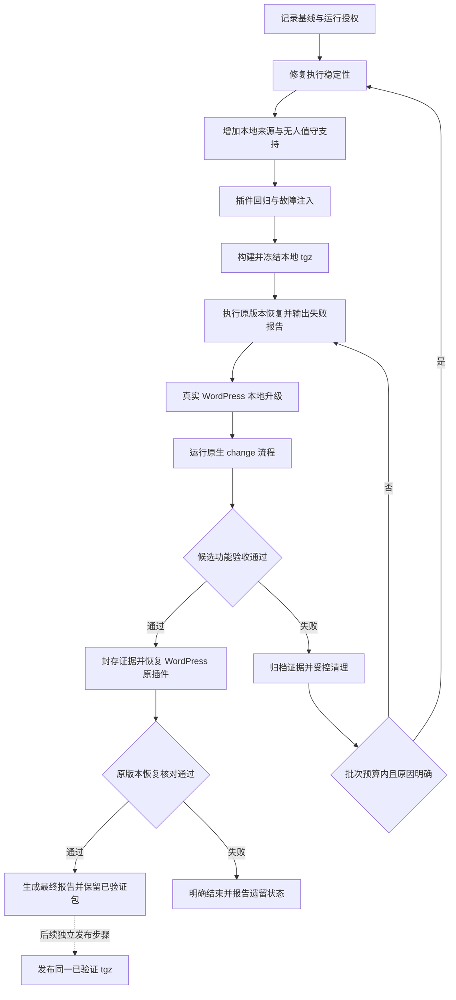

# Orchestrator 本地候选包与 WordPress 无人值守验证实施方案

日期：2026-10-14  
状态：用户于 2026-10-16 明确授权将总候选上限扩展至 5，正在续作；已用 3 个名额，剩余 2 个。前三个候选的功能验收 FAILED、原版本恢复 PASSED，原报告保留。详见 [最终报告](../../../../program/cctest/taskdescriptions/orchestrator-local-package-wordpress-validation/final-report.md) 和 [实施进度](../../../../program/cctest/taskdescriptions/orchestrator-local-package-wordpress-validation/progress.md)。本文保留原设计要求，未完成项不视为已验收。  
本次交付范围：按本方案实施、验证并恢复 WordPress 原插件；不发布 npm。

## 1. 目标与执行边界

在修复 Orchestrator 插件问题后，将新版本打成**本地 npm `.tgz` 包**，在真实 WordPress 工程中通过 `/change` 完整运行电话区号查询示例，并留下可核验的结果。

本次实施完成后应满足：

1. 验证前不执行 `npm publish`，候选包不上传 npm registry。
2. 插件、升级 CLI、调度服务、Worker、模板和校验器使用同一个冻结的本地候选包。
3. 在已经授予的本次运行范围内，方案生成、合同入队、执行、受控恢复及本地提交无需逐项点击确认。
4. 步数耗尽可以在明确预算内继续；不符合恢复条件时明确结束，不能无限重试或长期等待交互输入。
5. 验证同时覆盖正常完成和失败退出；保留原有测试、独立 Review、证据完整性及工作区所有权检查。
6. 自动化的交付终点是“真实 WordPress 验证通过、插件已恢复到试运行前的原版本，并生成完整报告”。恢复原版本是必做收尾，不是可选操作；仅候选验证通过不能宣布整项工作完成。
7. 正式 npm 发布属于验证完成后的独立步骤，不包含在本轮本地验证链路中。已验证的新包和试运行提交保留为交付产物，真实 WordPress 最终使用原插件版本。

“原版本”以步骤 01 采集并在实际切换前复核的安装快照为准，包含版本、来源、配置和受管文件；此前记录的 `1.3.3` 仅作为历史信息，不硬编码为恢复目标。升级前后若出现外部安装变化，应停止并报告基线漂移，不能自行改写恢复目标。

本地包不需要 npm 发布认证。依赖下载、模型请求及 Gradle 依赖解析仍可能使用网络，因此本方案不等同于完全离线运行。

2026-10-15 用户已明确要求开始实施本方案并及时更新进度文档。后续启动实施时，将任务范围和预算作为一次运行授权记录；运行过程中不重复询问同一范围内的操作。执行环境的文件写入、进程管理及模型调用权限需要预先具备，不能通过脚本绕过平台权限限制。

## 2. 工程、示例与已有诊断

### 2.1 工程位置

| 用途 | 路径 |
| --- | --- |
| 插件产品源码 | `/Users/zhanglong/files/npmprogram/opencode_android_orchestrator` |
| 真实 WordPress 工程 | `/Users/zhanglong/files/program/wordpresslocal/WordPress` |
| 方案与验证报告 | `/Users/zhanglong/files/program/cctest/taskdescriptions` |
| 拟议验证产物目录 | `taskdescriptions/orchestrator-local-package-wordpress-validation/` |

### 2.2 要运行的真实需求

```text
/change 优化域名注册时的电话区号查询：国家代码忽略大小写和首尾空格，例如 US、us、" US " 都返回区号 1。空白或未知国家代码返回空值。保持其他手机号处理行为不变，并补充单元测试。
```

业务改动限定在以下两个文件，实际运行前再次确认路径：

- `WordPress/src/main/java/org/wordpress/android/util/DomainPhoneNumberUtils.kt`
- `WordPress/src/test/java/org/wordpress/android/util/DomainPhoneNumberUtilsTest.kt`

插件升级文件、计划与合同文件另行登记归属，不计入上述业务文件授权。插件修复和 WordPress 业务修改分别形成提交与证据。

### 2.3 已确认的问题

此前对 1.3.3 和 `TASK-DIALCODENORM-003` 的诊断显示：

- Coder 配置为 `steps: 32`，第二次 RED 已通过后，日志出现 `Maximum steps for this agent have been reached.`，生产实现及后续门禁尚未完成。
- Coder 以退出码 0 结束，任务仍停留在 CODING，随后被标记 BLOCKED。退出码 0 本身不能证明任务完成。
- 大型状态输出、被拒绝的命令和首轮 RED 异常类型不匹配消耗了步骤；它们是促成因素，最终停点是步骤预算耗尽。
- 现有环境验证恢复策略不能直接用于恢复这类模型中断；新模型续跑权限必须单独设计。
- 本地安装器默认向 OpenCode 写入 npm 的 `包名@版本`；manifest 尚未记录本地制品来源与 tgz 摘要。
- readiness 的版本识别依赖数字和点的正则，本地来源和完整预发布版本需要同步适配。
- 当前 `/change` 仍要求新的方案确认和合同确认；`autoCommit` 仅替代最后的人工验收。

以上是历史诊断和源码检查结果，不代表执行时的实时状态。此前记录中，003 已中止并回退，队列暂停，但仍有 MIME 待处理任务和存活调度服务。步骤 01 必须重新检查，不能直接沿用历史 PID、HEAD 或队列结论。

## 3. 总体流程



“自动完成”以检查结果和任务状态为依据，不以模型最后一条自然语言回复为依据。

## 4. 分阶段实施步骤

### 步骤 01：记录起点并明确本次运行范围

**操作：**

1. 记录插件仓库的分支、HEAD、工作树变化、Node/npm/OpenCode 版本，以及 WordPress 的分支、HEAD、工作树变化和插件安装信息。
2. 读取 WordPress 的 queue、service、active、待处理任务、保留工作区、lease 和相关进程，只导出必要状态，不复制认证令牌或审批密钥。
3. 保存 WordPress 原插件的确切包内容、版本和来源，以及受管配置、模板、脚本、agent/skill、manifest、相关依赖记录、摘要与文件权限。快照必须足以恢复原安装，不能只记录一个版本字符串或依赖可能被清理的缓存目录。
4. 将本次验证限定为电话区号示例，使用新任务 ID 和专用试运行分支；记录原分支与 HEAD。验收后保留试运行分支和提交，并恢复真实工程的原插件安装及原工作分支；发现外部改动时不得强制覆盖。
5. 给运行批次分配 `runId`，记录授权范围、预算、候选包身份绑定规则及交付策略。实际候选摘要在步骤 07 冻结后绑定每轮任务授权。已有用户文件变化只记录，不自动清除。

**产物：** `baseline.json`、`run-authorization.json`、`original-installation/` 恢复包与清单。

**进入下一步条件：** 已知起点可恢复；没有把其他任务或用户文件纳入本次自动清理范围；本次批次授权可检查。

### 步骤 02：修复 Coder 步骤耗尽与状态输出问题

**操作：**

1. 为 `status.sh` 和插件 status 工具提供有字节上限的摘要输出。输出阶段、关键检查结果、剩余预算、失败原因和证据索引；完整证据保存在原文件中，按需分页读取。
2. 调整 Coder 指令，列出允许命令及替代读取方式，为生产实现和最终门禁保留步骤预算；将 64 步作为首轮评估值，通过故障注入决定最终值。
3. RED 失败报告同时给出用例、期望异常类型、实际异常类型及原始报告位置；让生成的断言与合同预期一致，不通过扩大可接受异常集合掩盖错误。
4. 从可验证的宿主结束信息中识别步骤耗尽。自然语言总结、退出码 0、日志中偶然出现的字符串均不能单独授权自动重试。
5. 增加独立的模型续跑账本，记录已使用次数、累计模型调用和时间预算。新 Worker 或服务重启后不能重新获得完整预算。
6. 续跑前核对合同、基线、HEAD、配置、当前 diff、RED 和冻结测试快照；沿用已封存事实，不重新捕获 baseline/RED，不重置测试准备次数、`codingCycle`、GREEN 实现门禁次数、Review 次数及各验证恢复账本。
7. 旧合同保持原语义。新的续跑策略由新合同显式记录，不能借升级给历史任务自动增加权限。

**拟议初始预算：** 每个任务最多自动续跑 1 次；保留现有执行总时限与阶段时限作为上限，并将“重建进程不刷新累计预算”列为硬约束。最终值写入合同，不能藏在提示词里。

**产物：** 稳定性修复、摘要接口、结构化停止原因、模型续跑账本及对应回归用例。

**进入下一步条件：** 可以可靠区分“完成、可续跑的步骤耗尽、不可自动恢复的退出”，并且所有分支都能给出明确结果。

### 步骤 03：增加统一的本地包来源支持

这是现有插件需要补齐的能力，不能只手工改一条 OpenCode 配置。

**操作：**

1. 设计统一的来源描述，支持现有 registry 来源和新增本地 tgz 来源，并贯穿升级、manifest、doctor、readiness 和运行记录。
2. 将制品身份与安装位置分开：身份包含包名、完整 SemVer、原始 tgz 的 SHA-256/SHA-512；绝对目录只用于本机定位。
3. 将本地包安装到按候选身份划分的独立目录。目录在使用期间不可原地覆盖；依赖安装结果、锁文件和实际版本一并记录。
4. 使用 OpenCode 支持的本地插件入口加载该目录中的编译产物。具体入口形式须在当前安装的 OpenCode 版本上实测，不能假定配置可以直接接受 tgz 路径。
5. 升级 CLI 从同一目录执行；OpenCode 插件启动时验证实际入口、版本和内容。调度器、Worker、Supervisor 与 bundled skills 均继续绑定该包路径。
6. 升级时通过受管事务更新本地入口、来源描述和 manifest，移除本次替换的旧 registry 引用。检查项目与全局配置，避免新旧插件同时加载。
7. doctor 同时检查源包身份、已安装内容、受管模板和实际入口，不能因来源为本地而跳过现有完整性检查。
8. readiness 读取结构化来源并支持完整 SemVer，比较已提交规划配置、安装 manifest 和实际运行包。信息缺失、路径失效或摘要不一致应明确拒绝启动。
9. 保持 registry 安装兼容；设计来源切换事务和按原始快照恢复旧版本的事务。原版本恢复必须还原整套安装，不依靠普通 upgrade 的降级行为，也不能任意放宽“同版本资源不可变化”校验。

**摘要保存规则：** tgz 自身摘要保存在包外候选清单、安装 manifest 和运行记录中。不能把摘要写回同一 tgz 后再打包，形成自引用。包内容校验表可单独列出文件和摘要，并明确排除校验表自身。

**产物：** 本地来源模型、升级入口、加载入口、manifest 迁移规则、doctor/readiness 适配、来源切换与恢复事务。

**进入下一步条件：** 不访问该候选版本的 registry 地址也能安装、启动和校验；每个实际运行进程都能证明使用相同候选。

### 步骤 04：增加受限的无人值守授权路径

**操作：**

1. 新增明确的运行授权模式，保留现有人工交互模式；普通需求文本中的“已批准”不自动产生授权。
2. 批次授权绑定本次需求摘要、真实仓库、原始基线、试运行分支规则、允许路径、验证范围、候选迭代上限、提交策略及有效期。
3. 每个候选试运行从批次授权派生一次任务授权，绑定具体候选摘要、计划与合同摘要、目标分支和预算。任务规划基线取受管升级提交后的 HEAD，任务授权绑定精确 `planningHead` 和执行配置摘要；保留它与原始基线的派生记录，只允许本批次登记的升级提交造成该变化。每份任务授权只允许一个任务版本入队。
4. 计划和合同仍须完整生成、校验和封存，审批记录标记为“委托批准”，不伪造宿主用户点击。
5. 入队与授权消费保持原子性；重复请求返回同一任务，不能重复启动。第二个候选使用新的任务授权，不能重用前一次凭据。
6. 新授权覆盖声明范围内的本地自动提交、受控恢复、失败归档以及最终恢复 WordPress 原插件的必做操作。为归档和原版本恢复预留独立、有限的收尾预算；执行额度耗尽或新工作授权到期后，仍完成已授权的精确收尾，不继续新任务。模型不能修改授权本身，不能扩大路径或提高预算。
7. 范围不符、合同矛盾、外部基线变化或预算耗尽时自动结束并报告，不停留在等待人工回答的状态。
8. 实际通过 `/change` 的 Planner、计划生成和合同封存入口运行。只调用可信操作者 CLI 执行手写合同不能计为原生 `/change` 全流程通过。

**拟议批次上限：** 最多 5 个候选包、每个候选最多 1 次真实 WordPress 示例入队。该值是待落地默认值，启动实施时固定；超过上限产生明确失败报告，不继续自行加轮次。

**产物：** 批次/任务授权结构、原子消费与幂等处理、委托审批审计、原生 `/change` 非交互路径。

**进入下一步条件：** 受限示例不需要逐项确认，同时范围扩大、重复授权和过期授权均被拒绝。

### 步骤 05：实现试运行驱动器与队列隔离

**操作：**

1. 新增驱动器，串联候选安装、环境检查、调用 `/change`、等待结构化结果、归档、强制恢复原插件与最终报告；脚本名称和 CLI 参数在实现时确定。
2. 驱动器保存自己的阶段账本。中断后先核对已完成阶段，再决定是否继续，禁止重复入队或重复提交。
3. 为真实 WordPress 增加按本次运行授权限定的调度范围，并串行执行本次任务。现有 enqueue 会恢复整个队列，必须覆盖这一行为，避免顺带启动 MIME 等其他待处理任务。范围限制必须持久化；授权过期、驱动器崩溃、服务重启或试运行结束均保持拒绝其他任务运行，不能自动撤销过滤后恢复历史队列。
4. 其他历史任务保留记录和原状态；本次运行范围外的任务不参与调度。若无法可靠隔离，则不得开始真实试运行，不能为方便而静默删除历史任务。
5. 为命令、模型阶段、Gradle 验证和整体批次设置超时、心跳和停止原因。普通进度通过本地日志和报告输出，不引入额外人工确认节点。
6. 检测子进程实际退出后才交接工作区；未知进程状态禁止启动第二个 Coder。

**产物：** 驱动器、阶段账本、任务范围过滤、结构化运行结果。

**进入下一步条件：** 可断点检查、可幂等结束；单次试运行不会改变其他待处理任务的调度结果。

### 步骤 06：在隔离环境完成插件测试与故障注入

测试使用独立临时仓库或独立 clone。普通 `git worktree` 共享 Git common directory，不能当作队列隔离环境。

**必须覆盖：**

| 场景 | 通过条件 |
| --- | --- |
| 大型 inventory/status | 输出遵守字节上限，分页可还原完整证据 |
| 强制较小步骤预算 | 检测到可信步骤耗尽，最多进行授权次数的续跑 |
| RED 后步骤耗尽 | 保留原 RED 和冻结测试，续跑进入实现与 GREEN |
| 续跑额度或时间耗尽 | 明确失败，不再调用模型，不遗留活动 Worker |
| 未知退出、超时、异常信号 | 不误判为可自动续跑的步骤耗尽 |
| 配置、HEAD、diff 或证据漂移 | 拒绝继续，保存具体差异和原因 |
| 进程/服务重启 | 累计预算不重置，不出现重复 Coder，历史任务仍被运行范围限制阻止 |
| 重复或过期授权 | 不重复入队，不产生新权限 |
| 新任务入队时存在历史排队任务 | 只有本次批次任务运行 |
| 本地包入口缺失或内容变化 | doctor/readiness 拒绝启动 |
| 同版本不同包或预发布版本 | 正确识别身份和 SemVer，不漏检 |
| 安装中断、终止、归档失败 | 保留事务状态和证据，报告可恢复位置 |
| 候选验证成功后的正常收尾 | 原版本、原来源、配置与受管文件恢复，实际加载原插件 |
| 原版本恢复中断或核对失败 | 记录未完成恢复，允许按账本幂等重入，整体不能标记通过 |

步骤预算等故障注入应发生在测试夹具中，不能通过改写已冻结的真实候选包进行。

**产物：** 测试结果、故障注入报告、失败状态及清理证据。

**进入下一步条件：** 必需测试全部通过。失败时先修复，不进入真实 WordPress。

### 步骤 07：构建并冻结本地候选包

**操作：**

1. 固定源码提交、依赖锁文件和构建环境，确保包内包含编译产物、模板、脚本与 bundled resources。
2. 使用未发布的新版本，禁止重新使用已安装的 `1.3.3` 打出不同内容后原地替换。
3. 执行产品构建和必要检查，再运行 `npm pack`，将 tgz 保存到本次候选目录。
4. 对实际生成的 tgz 计算 SHA-256、SHA-512，保存包文件清单、源码提交和依赖信息；将其标记为冻结候选。
5. 此后所有安装均使用该 tgz。任何源码、模板、版本或依赖修改都产生新候选，并重新执行必需验证。

示意目录：

```text
orchestrator-local-package-wordpress-validation/
  baseline.json
  run-authorization.json
  original-installation/
  candidates/<candidate-id>/
    package.tgz
    candidate.json
    package-files.json
    source-tests/
    isolated-install/
    wordpress-run/
  restoration/
    restore-report.json
    restored-doctor.json
    restored-load.json
  final-report.md
  final-report.json
```

版本策略：可以采用独立预发布版本，也可以先在本地验证尚未发布的最终版本。若把 `1.3.4-rc.1` 改成 `1.3.4`，包内容已变化，最终包必须重新验证。文中版本号仅为示例，不代表已选定或已发布。

**产物：** 不可变 tgz、候选清单、文件清单和摘要。

**进入下一步条件：** 产物身份唯一，来源可追溯，未上传 npm。

### 步骤 08：验证打包后的安装与升级链路

**操作：**

1. 在独立目录从冻结 tgz 安装，检查缺失文件、依赖解析、可执行权限和实际入口。
2. 在独立 WordPress clone 或受控 Android 夹具中，分别验证已有 registry 安装升级到本地来源、新建安装、doctor 与 readiness。
3. 启动新的 OpenCode 会话，记录本地插件入口、版本和摘要；确认工具已注册且没有重复加载旧插件。
4. 启动调度服务并检查 Worker 来源，验证试运行驱动器可以完成一条隔离任务。
5. 演练安装恢复事务，覆盖候选验证成功后的主动恢复、失败恢复及恢复中断重入；确认原版本、原来源、受管文件和旧版本实际加载均正确，且不覆盖新的任务审计记录。

这里验证的是包内真实内容；源码目录测试通过不能替代这一阶段。

**产物：** 包安装日志、实际加载证明、doctor 结果、升级和恢复演练结果。

**进入下一步条件：** 冻结包的真实安装与原版本恢复链路均通过，才允许接触真实 WordPress 的运行配置；恢复演练失败时不升级真实工程。

### 步骤 09：准备真实 WordPress 工程

**操作：**

1. 重新采集 Git、queue、service、lease 和进程状态，与步骤 01 对比。
2. 若存在占用任务，先在现有调度器可处理的情况下完成已授权的归档/中止，再停止旧调度服务。不能先停掉处理归档所需的服务；本批次授权不自动允许中止其他任务，没有对应授权时记录前置条件失败并结束本次尝试。
3. 确认旧 Worker、Supervisor 及该任务启动的构建子进程已退出，不根据历史 PID 直接发送信号。
4. 保持队列暂停、旧服务停止，记录 MIME 等历史任务。升级完成后、首次启动新调度器前，应用步骤 05 的试运行调度范围；核验新入队不会恢复其他任务执行。
5. 创建专用试运行分支，记录旧包、旧配置、manifest 和受管文件恢复点；不自动 stash、删除或提交无法归属本次任务的用户改动。
6. 通过候选包的本地 CLI 执行受管升级，检查差异归属，仅提交本次插件升级和运行配置。
7. 重新启动 OpenCode，运行 doctor/readiness，确认规划将使用升级后的提交与同一候选身份。

**产物：** 真实工程升级记录、升级提交、实际加载证明、fresh planning snapshot。

**进入下一步条件：** 本次试运行独占执行槽、配置与安装一致、工作区符合已有例外规则。`automation/automation-commit-prefix` 的既有例外保持有效，不自动提交该文件的用户变化。

### 步骤 10：运行原生 `/change` 电话区号示例

**操作：**

1. 驱动器提交第 2.2 节的原始需求，使用新任务 ID 和该候选专属任务授权。
2. Planner 读取新的固定快照，生成方案、测试说明和合同；委托审批路径核对范围后封存并原子入队。
3. 执行既定工作流：baseline → 新增测试与有效 RED → 生产实现 → GREEN → 合同要求的 affected/debug 验证 → 独立 Review → 授权的本地提交和集成。
4. 测试命令和构建范围来自工程能力发现与合同。具体模块和变体在执行时确认，不用任意较小测试集合替代已批准范围。
5. 有效 RED 应证明新行为在修改前失败，原有回归用例仍符合要求；GREEN 后新旧用例全部通过。
6. 需要续跑时执行步骤 02 的校验和累计预算规则；不得重新生成已冻结测试来掩盖失败。
7. 业务提交保留在专用试运行分支；本方案不包含把业务结果推送远端或合并到用户原工作分支。

**至少覆盖的业务用例：**

| 输入或行为 | 期望 |
| --- | --- |
| `US`、`us`、`Us` | 字符串 `"1"` |
| `" US "`、`" us "` | 字符串 `"1"` |
| `GB`、`" gb "` | 字符串 `"44"` |
| `""`、`"   "`、仅制表符/换行的字符串 | `null` |
| `ZZ`、`" zz "` | `null` |
| 原有合法国家代码 | 保持原有映射结果 |
| 既有完整号码解析和手机号格式化测试 | 行为与基线一致 |

国家代码大小写处理应独立于系统 locale；不新增原签名未要求的 nullable 输入能力。函数职责外的号码逻辑不纳入本次修改。

**产物：** 计划/合同、授权审计、baseline/RED/GREEN、验证报告、Review、业务提交。

**进入下一步条件：** 达到真正的完成状态，且完成记录能关联具体候选、合同、测试和提交。

### 步骤 11：完成候选验收并封存结果

**操作：**

1. 核对任务为 `COMPLETED`，所有合同要求的门禁和独立 Review 有通过证据。
2. 核对实际业务差异仅涉及允许路径，其他手机号行为的回归证据完整。
3. 核对本次任务的 Worker、Supervisor 和构建子进程均退出，active 为空，任务 lease 已释放。
4. 先持久化队列暂停状态，再停止本次启动的调度服务，随后才能撤销本次运行过滤；确认其他历史任务没有被执行、取消或改写授权，结束后不自动恢复队列消费。
5. 核对试运行分支与工作区状态，区分升级提交和业务提交，保存试运行分支、提交及完整证据，供恢复原插件后继续查看验收结果。
6. 输出候选验收记录，包含候选身份、实际加载来源、源码提交、环境版本、任务 ID、测试数、耗时、恢复次数和业务提交；随后必须进入步骤 12，不能停留在候选安装状态交付。

**产物：** 候选验收记录、冻结的已验证包及证据索引。

**进入下一步条件：** 候选代码、测试、任务结果与证据一致。此时仅表示候选验收通过，原版本恢复尚未完成。

### 步骤 12：强制恢复 WordPress 原插件并完成最终验收

本步骤为成功验收后的必做操作，包含在同一自动化批次中，无需另行确认；批次失败并最终退出时也执行相同恢复要求。

**操作：**

1. 确认候选结果已归档，队列暂停状态已持久化；退出本次加载候选的 OpenCode 会话，停止候选调度服务，并确认本次 Worker、Supervisor 和构建子进程全部退出。
2. 校验步骤 01 的原安装恢复清单、原包内容和摘要。恢复目标取该基线，不取 `latest`，不根据当前 registry 标签推断。
3. 通过步骤 08 已演练的受管恢复事务，还原原插件版本和来源、OpenCode 配置、模板、脚本、agent/skill、安装 manifest、相关依赖记录及权限；只移除本次登记的临时入口和引用。
4. 保留候选产物和试运行分支，恢复原工作分支与原安装相匹配的受管文件。保护原有用户改动；检测到外部提交或修改时停止覆盖操作，记录恢复冲突。
5. 处理候选新增的运行元数据与旧版本兼容性，保留本次任务终态、日志、授权和恢复审计。不用旧 queue 快照覆盖当前记录，不让旧调度器直接消费其不支持的新格式。兼容处理方式必须已在隔离环境验证；无法证明兼容时保持服务停止，并将恢复记为未完成。
6. 使用原版本的 CLI 执行 doctor，并核对恢复后的包内容、manifest、受管文件摘要和权限。以原始快照为基准检查，不用候选版本的期望值代替。
7. 在队列保持暂停、禁止入队的条件下启动一次新的 OpenCode 验证会话，确认实际加载原版本和原入口，工具注册正常，候选插件没有继续加载或与原版重复加载；验证后退出该会话。
8. 再次核对 active 为空、任务 lease 已释放、候选相关进程不存在、历史任务未启动；最终队列保持暂停、调度服务停止，即使试运行前服务存活也不自动恢复消费。
9. 保存原版本恢复报告，列出原版本、候选版本、恢复后版本、包来源、摘要对比、doctor 结果、实际加载证据、分支和工作树差异、任务兼容性处理及最终服务状态。
10. 生成最终报告，将“候选功能验收”和“原版本恢复”分别记录。两项都通过才标记整个批次 `PASSED`；恢复失败时保留候选已通过的事实，但整体标记未完成恢复，报告实际遗留状态。

**恢复范围：**

| 对象 | 最终要求 |
| --- | --- |
| WordPress 的插件版本与来源 | 与试运行前快照一致 |
| 配置、模板、脚本、agent/skill、manifest、依赖记录和权限 | 恢复原安装，清除本次临时加载引用 |
| 实际运行的插件 | 新会话证明加载原版本，不残留候选进程 |
| 原工作分支和用户文件 | 与恢复基线匹配，外部变化不覆盖 |
| 候选包、业务示例提交和验证证据 | 保留在候选目录、专用分支和审计记录中 |
| 队列及调度服务 | 暂停且停止，历史任务不自动执行 |

**产物：** `restoration/restore-report.json`、`restoration/restored-doctor.json`、`restoration/restored-load.json`、`final-report.md`、`final-report.json`。

**通过标准：** 真实 WordPress 已恢复原插件，原版本实际加载及配置校验通过，队列与进程收尾完成，候选验收证据仍可追溯。仅修改版本号、只 checkout 分支、仅退出候选进程或只删除本地包均不能算恢复完成。

### 步骤 13：失败处理与有限迭代

**处理顺序：**

1. 持久化队列暂停状态并停止分配新的普通执行，保留本次范围限制，记录结构化原因、所在阶段和剩余预算。若归档依赖调度器，仅允许本次已授权的归档操作继续。
2. 保存日志、命令结果、阶段账本、当前 diff、合同与候选身份，生成归档清单。
3. 确认所有相关进程退出，再按已登记的任务所有权归档业务改动、回退本次工作区并释放 lease。
4. 按步骤 12 的恢复要求执行原安装恢复；批次最终退出时，无论候选功能验证成功还是失败，都必须尝试恢复原版本并核对结果。不通过任意降级命令或全仓库强制 reset 替代恢复。
5. 不用旧 queue 快照覆盖新任务记录；归档完成或失败后停止相关服务，确认暂停状态已持久化后才能撤销本次过滤。旧调度器恢复前必须检查是否能理解当前状态，必要时保持停止并报告。
6. 只有前一次归档与原安装恢复已核验、原因明确、修复仍在批次授权范围内且预算尚有余量时，才形成新候选，从必要的前置阶段重新开始；第二次真实任务使用新的任务授权。恢复未完成时不得继续叠加候选安装。
7. 超出范围、预算耗尽、归档失败或发现外部改动时停止新的候选迭代，进入预留的收尾预算执行原版本恢复；若无法安全完成，则结束并报告未恢复项目、实际保留的文件、进程、lease 和恢复入口，不能将恢复失败记为成功。

失败时可以留下已归档证据或为保护未知文件而保留的工作区，但必须明确报告。不得同时宣称“已完全回退、已释放所有资源”。

## 5. 实现位置与改动清单

以下路径以插件产品仓库为根，用于安排实施；新文件名在落地时确定。

| 改动主题 | 主要现有位置 |
| --- | --- |
| Coder 预算与命令指引 | `templates/.opencode/agents/scheduled-coder.md` |
| 阶段判定与模型续跑 | `templates/scripts/automation/orchestrate-task.sh`、`src/queue/` |
| 状态摘要与分页 | `templates/scripts/automation/status.sh`、`src/tools/index.ts` |
| RED 异常诊断 | `templates/automation/verification/inventory.cjs` |
| 本地来源与配置生成 | `src/installer/opencode-config.ts`、`src/installer/init.ts`、`src/installer/upgrade.ts` |
| 安装身份与恢复事务 | `src/installer/install-manifest.ts`、`src/installer/upgrade.ts` |
| doctor/readiness | `src/doctor/installation.ts`、`src/queue/preconditions.ts` |
| 委托审批与原生 change | `src/queue/approvals.ts`、`src/queue/tools.ts`、`templates/.opencode/commands/change.md`、Planner 模板及相关 bundled skill |
| 调度范围与进程收尾 | `src/queue/queue.ts`、`src/queue/service.ts`、`src/queue/supervision.ts` |
| 回归与使用文档 | `tests/`、`docs/QUEUE.md`、`docs/SECURITY.md`、`docs/MIGRATION.md`、`README.md` |

实施时同步维护包元数据、锁文件、模板版本、文档约束及既有发布一致性检查。不能只改源码而漏掉随包安装的模板或技能指令。

## 6. 运行状态与预算约定

下表是驱动器的拟议状态，不代表当前队列已经支持同名状态。队列内部可沿用原状态，并通过结构化原因关联驱动器状态。

| 驱动器状态 | 含义 | 后续动作 |
| --- | --- | --- |
| `PREPARING` | 检查环境和候选身份 | 满足条件后安装 |
| `INSTALLING` | 受管升级事务进行中 | 成功后校验；失败后事务恢复 |
| `RUNNING` | 当前授权任务执行中 | 监测预算和阶段结果 |
| `CONTINUING` | 可信步骤耗尽且满足续跑条件 | 消费一次续跑额度 |
| `ARCHIVING` | 保存失败证据并清理本次资源 | 不允许新 Coder 启动 |
| `RESTORING` | 恢复 WordPress 原插件并检查实际加载 | 保持队列暂停，不启动新任务 |
| `PASSED` | 候选验收和原版本恢复均通过 | 输出已验证包与最终报告 |
| `RESTORE_FAILED` | 原版本恢复或恢复后核对未完成 | 保留证据，报告遗留状态，整体不算完成 |
| `FAILED` | 预算、范围或检查不满足 | 输出失败及遗留状态，结束批次 |

每个阶段记录开始/结束时间、截止时间、心跳和退出原因。驱动器重启、服务重启、替换 Worker、重复读取结果均不能重置累计预算。模型续跑、环境验证重试、测试准备修复和 Review 预算分别记账；原版本恢复使用预先保留的独立有限收尾预算，不因候选执行额度耗尽而跳过。

## 7. 最终验收清单

本轮未通过整体验收。下列故障注入和重复运行结论来自回归/打包夹具；真实 WordPress 的方案、合同、业务测试和 Review 均未执行，不以夹具替代真实验收。

- [x] 未验证候选没有发布到 npm。
- [x] 使用冻结 tgz 安装，记录版本、源码提交和包摘要。
- [ ] 插件、CLI、调度器、Worker 与模板的实际来源一致。
- [ ] 本地加载、升级、doctor、readiness 和恢复事务全部通过。
- [ ] 原生 `/change` 的方案与合同生成真实执行，无逐项人工确认。
- [x] 委托授权可审计，未伪造用户点击，未向旧任务追加权限。
- [x] 其他历史任务没有因本次入队而启动。
- [ ] 电话区号输入矩阵与原有手机号回归测试通过。
- [ ] RED、GREEN、合同要求的验证及独立 Review 证据完整。
- [x] 步数耗尽、累计预算、未知退出和中断恢复的故障注入通过。
- [x] 重复请求不重复入队、不重复提交、不重置预算。
- [ ] 成功任务真正完成；失败任务明确结束并报告实际遗留情况。
- [x] 进程、active、lease、分支和工作树收尾与报告一致。
- [x] WordPress 插件已恢复到步骤 01 记录的原版本和原来源，原配置、受管文件、依赖记录与 manifest 一致。
- [x] 原版本 doctor 及新 OpenCode 会话实际加载核对通过，无候选插件重复加载或残留进程。
- [x] 原工作分支和用户文件得到保护，候选提交与验证证据保留可查。
- [x] 恢复后的运行元数据与旧版本兼容，未用旧 queue 快照覆盖本次审计；最终队列暂停、服务停止。
- [x] 最终报告分别记录候选验收和原版本恢复结果，两项都通过才算整个批次完成。
- [ ] 自动化报告绑定本次候选、合同、测试报告及最终提交。

一次成功只能证明该候选在记录环境和用例范围内通过；稳定性结论还需要上述失败路径证据，不承诺未来任何任务都不会遇到外部故障。

## 8. 验证通过后的 npm 发布衔接

本节是后续独立工作，不属于本轮自动化验证执行范围。

1. 核对拟发布版本仍可用，候选身份与通过报告完全一致。
2. 按账户现有认证方式发布已经验证的 tgz，例如 `npm publish /path/to/verified-package.tgz`；不重新打包不同字节的产物。
3. 发布后核对 registry 的版本、tarball 完整性和包内容。
4. 本次真实 WordPress 已恢复原插件，后续发布不会自动将它再次升级。需要验证新版本的 registry 下载与加载时优先使用独立环境；真实工程再次升级属于后续独立任务。
5. 若发布前修改了包内容、版本或依赖，则生成新候选并重新验证。本地验证通过不等于 registry 下载与加载已经验证。

## 9. 参考依据

- [npm pack：生成本地包](https://docs.npmjs.com/cli/pack/)
- [npm install：安装本地 tarball](https://docs.npmjs.com/cli/install/)
- [OpenCode：本地插件、依赖与加载顺序](https://docs.opencode.ai/docs/plugins/)
- 本方案还依据当前 1.3.3 源码检查及此前 WordPress 步数耗尽诊断。正式实施前重新核对环境与源码版本，并将实际结果写入独立完成报告，不把本文中的待办描述改写成已经完成的事实。
